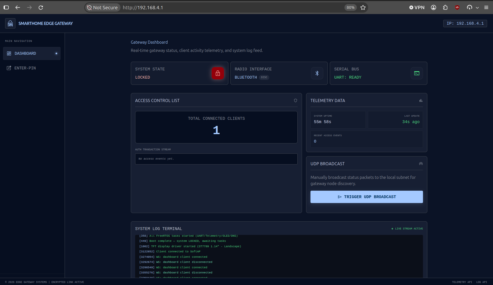
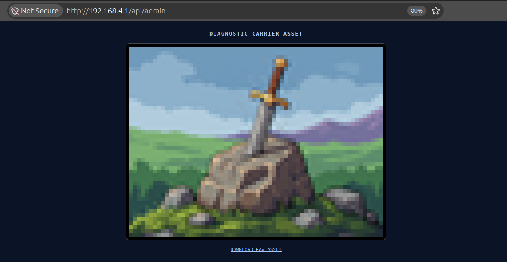
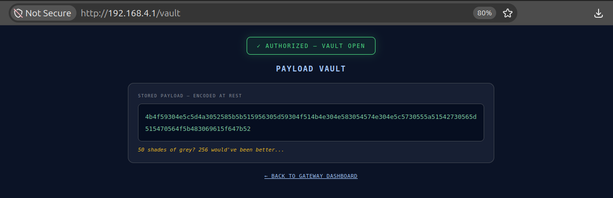

# Hidden Portal (250 pts)

Getting status via UART:
```
{"event":"status_update","uptime_ms":1720420,"status":"LOCKED","wifi_clients":0,"ble_status":"DISCONNECTED","uart_status":"READY","recent_access":[]}
```

Checking stated WiFi point, strings shows some SoftAP info:
```
$ strings 4-web_merged.bin | grep -i softap
Client connected to SoftAP
Client disconnected from SoftAP (reason 
WARN: softAPConfig failed 
SoftAP '
ERROR: SoftAP failed to start
 SoftAP disabled; reboot to restore
 SoftAP lockdown engaged (power-cycle to restore)
Invalid authmode %d configured for softAP
```
Checking existing networks:
```
$ nmcli device wifi list | grep GW
        B8:D6:1A:4C:48:65  SmartHomeGW_4C4864       Infra  11    135 Mbit/s  60      ▂▄▆_  WPA2  
```

Connecting:
```
$ nmcli device wifi connect "SmartHomeGW_4C4864" \
  password "gateway-secure-2026" \
  bssid B8:D6:1A:4C:48:65
Device 'wlp0s20f3' successfully activated with '8508cf1e-b1c0-4bf9-868f-54dcc0fbc69e'.
```

Confirmation from the logs:
```
[3122852] Client connected to SoftAP
{"event":"status_update","uptime_ms":3165811,"status":"LOCKED","wifi_clients":1,"ble_status":"DISCONNECTED","uart_status":"READY","recent_access":[]}
```


Checking strings if there's anything related to web pages:
```
$ strings 4-web_merged.bin | grep -i dashboard
,"dev_dashboard":"
WS: dashboard client connected
WS: dashboard client disconnected
Web Dashboard
Web dashboard started on port 80 (SmartHome Gateway Dashboard)
<a href="/">&larr; Back to gateway dashboard</a>
<a href="/">&larr; Back to gateway dashboard</a>

$ strings 4-web_merged.bin | grep -e "<.*>
[...]
```

Checking 192.168.4.1:80


In logs (http://192.168.4.1/api/log?since=0) there is a message
```
"[358] Telemetry broadcast task started (UDP port 4210)"
```

Checking broadcast message. Found dev_dashboard endpoint:
```
$ sudo tcpdump -ni wlp0s20f3 -A -s 0   'udp and src host 192.168.4.1 and port 4210'
tcpdump: verbose output suppressed, use -v[v]... for full protocol decode
listening on wlp0s20f3, link-type EN10MB (Ethernet), snapshot length 262144 bytes
20:33:10.200697 IP 192.168.4.1.4210 > 192.168.4.255.4210: UDP, length 178
E....}..@..Q.........r.r....{"event":"status_update","uptime_ms":4049578,"status":"LOCKED","wifi_clients":1,"ble_status":"DISCONNECTED","uart_status":"READY","recent_access":[],"dev_dashboard":"/api/admin"}
^C
```



Uploading and checking admin.png
```
$ exiftool admin.png 
ExifTool Version Number         : 12.76
File Name                       : admin.png
Directory                       : .
File Size                       : 9.4 kB
File Modification Date/Time     : 2026:10:26 20:34:39+01:00
File Access Date/Time           : 2026:10:26 20:34:39+01:00
File Inode Change Date/Time     : 2026:10:26 20:34:39+01:00
File Permissions                : -rw-rw-r--
File Type                       : PNG
File Type Extension             : png
MIME Type                       : image/png
Image Width                     : 64
Image Height                    : 48
Bit Depth                       : 8
Color Type                      : RGB
Compression                     : Deflate/Inflate
Filter                          : Adaptive
Interlace                       : Noninterlaced
Comment                         : steganography
Software                        : steganography
Image Size                      : 64x48
Megapixels                      : 0.003
```

Checking stated steganography:
```
$ zsteg -a admin.png
meta Comment        .. text: "steganography"
meta Software       .. [same as "meta Comment"]
imagedata           .. text: "p<.X3&Vu"
b1,r,lsb,xy         .. text: "PIN:4390"
```

Entering PIN, getting to vault



```
4b4f59304e5c5d4a3052585b5b515956305d59304f514b4e304e583054574e304e5c5730555a51542730565d515470564f5b483069615f647b52
```

Ok, Gray code (https://en.wikipedia.org/wiki/Gray_code)
```
$ python3 grey.py 
run this command in uart to get the flag: diag_dump NAjGRc
```

Posting command:
```
Diagnostic dump authorized. Flag: esc_2026{50_shades_of_grey_77a7d0147d862881}
[7017169] UART CLI: privileged diagnostic authorized (valid token)
```

Flag: **esc_2026{50_shades_of_grey_77a7d0147d862881}**